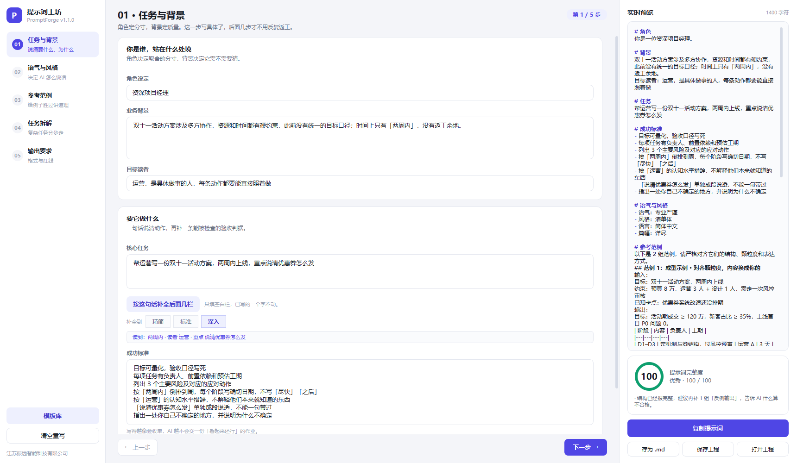
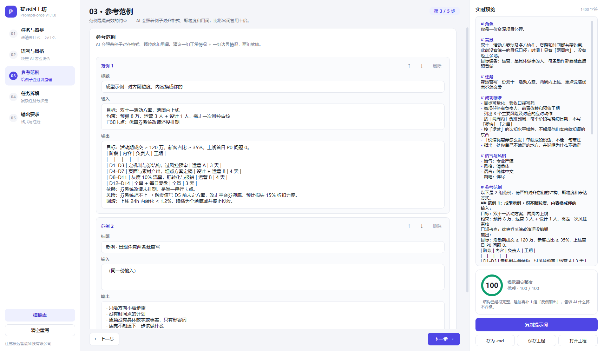

# 提示词工坊 PromptForge v1.2.0

> 把「随手问 AI」变成「结构化下指令」的桌面小工具。



**[下载 Windows 版](https://github.com/355744444-source/promptforge/releases/latest)** · 单文件 exe，双击即用，不装 Python

写提示词真正难的地方，从来不是措辞客气不客气。一份能让 AI 一次交对的提示词，
通常要有四样东西：

1. **明确任务与背景** —— 它才知道自己在什么处境下、为谁做、做到什么程度算完成；
2. **规定语气与风格** —— 否则它会给你一份"什么都对、但谁都不像"的中间态文案；
3. **提供参考范例** —— 例子比形容词管用十倍；
4. **拆解复杂任务** —— 不拆解，它就容易只做完前半段。

PromptForge 把这四件事做成五步表单，右边**实时**生成一段可直接粘贴的提示词，
并给一个 0–100 的完整度评分，缺哪块就提示补哪块。

如果你懒得分五步填，可以只在第 1 步写一句需求，点 **按这句话补全后面几栏**：

```
帮运营写一份双十一活动方案，两周内上线，重点说清优惠券怎么发
        ↓ 先从这句话里读出：两周内 · 读者 运营 · 重点 说清优惠券怎么发
角色：资深项目经理
背景：双十一活动方案涉及多方协作，资源和时间都有硬约束…；时间上只有「两周内」，没有返工余地
读者：运营，是具体做事的人，每条动作都要能直接照着做
成功标准：目标可量化，验收口径写死 / 按「两周内」倒排到周，每个阶段写确切日期 /
          「说清优惠券怎么发」单独成段说透，不能一句带过 …
范例：一份带真实数字的成型示例（阶段表 / 风险 / 回滚）+ 一组反例
步骤：定目标与验收 → 拆阶段 → 排依赖与负责人 → 列风险与回滚 → 对着验收标准自查
        ↓
完整度 12 → 100 分
```

补全**只填空白栏位**，你已经写过的内容一个字都不会动；再点一次也不会有副作用。

## 三种补全深度

| 档位 | 补什么 | 什么时候用 |
|---|---|---|
| 精简 | 角色、背景、读者、语气、风格、篇幅、格式 | 正文想自己写，只要个框架 |
| 标准 | 上面 + 成功标准、必须包含、禁止项、结构、范例骨架、3–4 步 | 日常够用 |
| 深入 | 上面 + 成型范例 + 反例 + 自查步骤 + 2 条深度判据 | 想直接拿去用 |



## 它会从你那句话里读什么

| 读到的 | 例子 | 落到哪 |
|---|---|---|
| 工期 | 「两周内」「3 天内」「本周五前」 | 成功标准按工期倒排 / 给最小版本 / 反推发出 |
| 数量 | 「3 个版本」「5 条」 | 必须包含横向对比，成功标准要求标注各自角度 |
| 页数 | 「控制在 10 页」 | 必须包含「总页数 ≤ 10 页」 |
| 渠道 | 小红书 / 公众号 / 抖音 / 邮件 / 周报 / PPT / 详情页 / 朋友圈 / 知乎 | 直接注入该渠道的硬性惯例，并替换同主题的通用描述 |
| 受众 | 「给运营团队」「给客户」「给老板」 | 替换通用读者描述，按角色补特征（决策者看结论、执行者要动作） |
| 技术栈 | Python / C++ / SQL / Excel… | 统一技术栈，注明依赖版本 |
| 禁忌 | 「不要用 pandas」 | 写进禁止项，排在最前 |
| 强调点 | 「重点突出性价比」 | 要求单独成段说透 |

渠道惯例是**可执行的规则**，不是形容词。比如选到小红书，成功标准会变成
「标题 ≤20 字且含 1 个具体数字」「结尾带 3–5 个话题标签」「不出现最 / 第一 / 绝对」；
选到 PPT 会变成「一页一个结论，标题写成判断句」「每页正文不超过 5 行」。

读不到硬信息时，界面会直接说「补上工期、受众或发布渠道会准很多」，
而不是硬塞一堆对谁都适用的空话。

---

## 界面

```
┌──────────┬───────────────────────────┬──────────────┐
│ 步骤导航  │  当前步骤的表单（可滚动）    │  实时预览     │
│ 01–05    │                           │  完整度评分   │
│ 模板库    │                           │  复制 / 导出  │
└──────────┴───────────────────────────┴──────────────┘
```

## 五个步骤

| 步骤 | 填什么 | 为什么重要 |
|---|---|---|
| 01 任务与背景 | 角色、业务背景、目标读者、核心任务、成功标准 | 角色定分寸，背景定质量；成功标准决定它交付什么 |
| 02 语气与风格 | 语气（单选）、风格（多选）、语言、篇幅、文风示例 | 不指定，AI 会用"最安全"的腔调 |
| 03 参考范例 | 若干组「输入 / 输出」，可增删、可排序 | 锁定格式与颗粒度，比任何形容词都准 |
| 04 任务拆解 | 执行方式 + 3–5 个步骤（每步可加说明） | 复杂任务不拆解，后半段必漏 |
| 05 输出要求 | 输出格式、结构要求、必须包含、不要出现 | 反向约束（不要什么）往往比正向要求更有效 |

## 功能

- **一句话自动补全**：写一句需求，一键补齐后面所有栏位（只补空白，不覆盖），三档深度可选
- **需求解析**：从这句话里读出工期、数量、页数、渠道、受众、技术栈、禁忌、强调点，再据此生成
- **实时预览**：改一个字，右边的提示词立刻变
- **完整度评分**：0–100，按 8 项权重扣分，并给出最高优先级的 3 条改进建议
- **8 个起步模板**：写功能代码 / 代码审查 / 社交文案 / 数据分析 / 周报方案 / 翻译润色 / 概念讲解 / 会议纪要
- **工程保存**：`保存工程` 存成 `.pfz`（本质是 JSON），下次可继续改
- **导出**：复制到剪贴板，或存成 `.md` / `.txt`
- **快捷键**：`Ctrl+S` 存 Markdown、`Ctrl+O` 打开工程、`Ctrl+N` 清空

## 运行

到 [Releases](https://github.com/355744444-source/promptforge/releases/latest) 下载 `PromptForge_v1.2.0.exe`，双击即用，无需安装 Python 或任何依赖（Windows 10/11 x64）。

从源码运行：

```bash
pip install PySide6-Essentials
python main.py
```

自己打包：

```bash
pip install PySide6-Essentials pyinstaller
pyinstaller --noconfirm --clean promptforge.spec
```

## 构建

```bash
pip install PySide6-Essentials pyinstaller
python tools/make_icon.py          # 生成 assets/app.ico
pyinstaller --noconfirm --clean promptforge.spec
```

产物在 `dist/PromptForge.exe`（单文件，无控制台窗口）。

## 目录结构

```
promptforge/
├─ main.py              入口（DPI、字体、图标、窗口）
├─ pforge/
│  ├─ theme.py          设计令牌 + 全局 QSS + 步骤定义
│  ├─ widgets.py        卡片、芯片组、自适应输入框、评分环、预览高亮
│  ├─ model.py          PromptSpec 数据模型 + .pfz 序列化
│  ├─ prompts.py        提示词渲染、完整度评分、8 个模板
│  ├─ slots.py          需求槽位抽取（工期/数量/页数/渠道/受众/技术栈/禁忌）
│  ├─ autofill.py       自动补全（9 档意图 + 槽位规则 + 三档深度）
│  └─ app.py            主窗口、五个步骤页、模板弹窗、保存/打开
├─ tools/
│  ├─ make_icon.py      生成图标
│  ├─ shot.py           离屏渲染截图（开发自查用）
│  └─ smoke_gui.py      无头交互冒烟测试
├─ tests/
│  ├─ test_core.py      纯逻辑单元测试（22 项）
│  ├─ test_autofill.py  自动补全引擎测试（25 项）
│  └─ test_slots.py     槽位抽取与深度档测试（34 项）
├─ assets/              图标
└─ promptforge.spec     打包配置
```

## 开发自查

```bash
python -m unittest discover -s tests -v   # 81 项单元测试
python tools/smoke_gui.py                 # 33 项界面交互检查
python tools/shot.py --step 0 --out a.png # 离屏截图，肉眼验收版式
```

## 已知限制

- 自动补全走**本地规则库**，覆盖 9 类意图 + 9 个渠道；主题偏离这些场景时会退回通用结构，需要手工改写；
- 槽位抽取是正则 + 词表，读不懂反讽、隐含条件和跨句指代；句中信息越明确，补得越准；
- 标准档给出的**范例是结构骨架**，只有深入档才有成型示例，且示例是虚构的（标了「内容换成你的」），不会替你编造真实数据；
- 生成的是**厂商中立**的 Markdown 纯文本，不针对任何一家模型的专有格式做适配；
- 完整度评分是启发式的规则打分（8 项权重），不是模型评分，只能用来提示"哪块空着";
- 输入框高度随内容增长，但长文档会在框内滚动，不做无限增高；
- 未做多语言界面（仅简体中文）。

---

江苏振远智能科技有限公司 · 2026
